# Editable architecture diagrams

Current unless explicitly marked proposed/future. These C4-style context/container views use standard Mermaid flowcharts. Runtime arrows are distinct from compile-time imports.

## 1. C4 system context

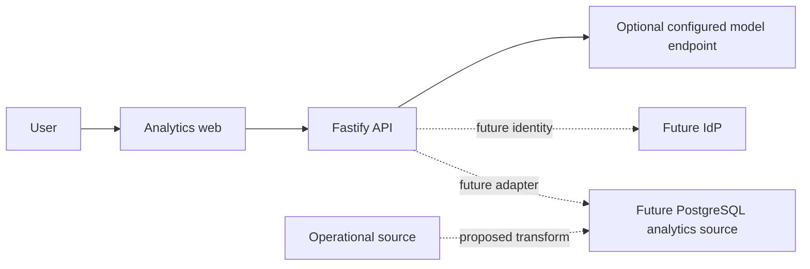

## 2. C4 containers

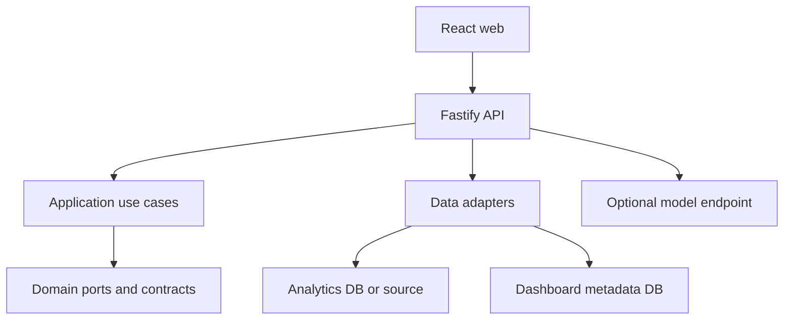

## 3. Compile-time package dependencies

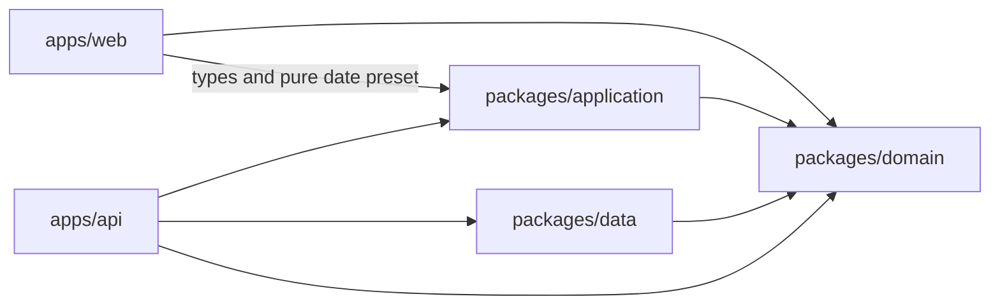

## 4. Dashboard execution

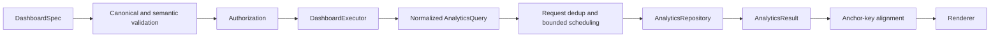

## 5. Manual builder

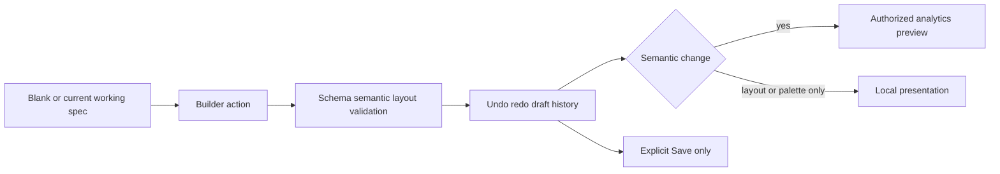

## 6. Metric drag and drop

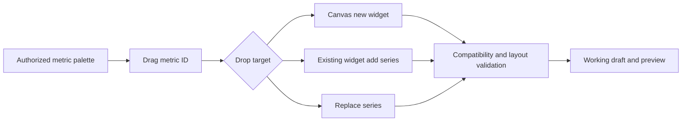

## 7. AI generation

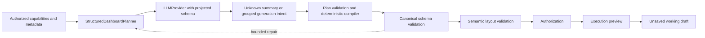

## 8. AI editing

```mermaid
flowchart LR
 D[Working spec and instruction] --> P[Planner with authorized capabilities]
 P --> L[Provider projected sparse edit schema]
 L --> J[Unknown DashboardEditPlan JSON]
 J --> I[Plan validation and deterministic compiler]
 I --> V[Canonical patch validation]
 V --> N[Atomic patch application]
 N --> S[Completed spec schema and semantics]
 S --> A[Post-validation authorization]
 A --> E[Execute draft preview]
 E --> W[Working draft only]
 W --> B[Explicit Save]
```

## 9. Authentication and authorization

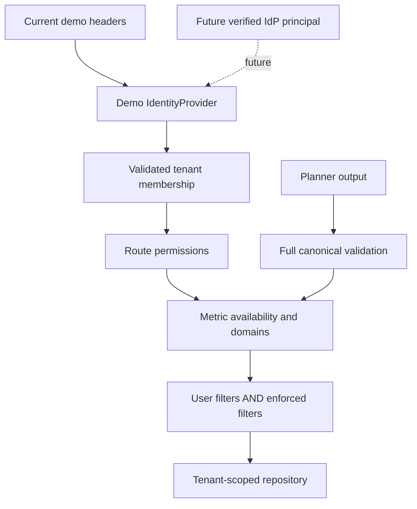

## 10. Saved dashboard lifecycle

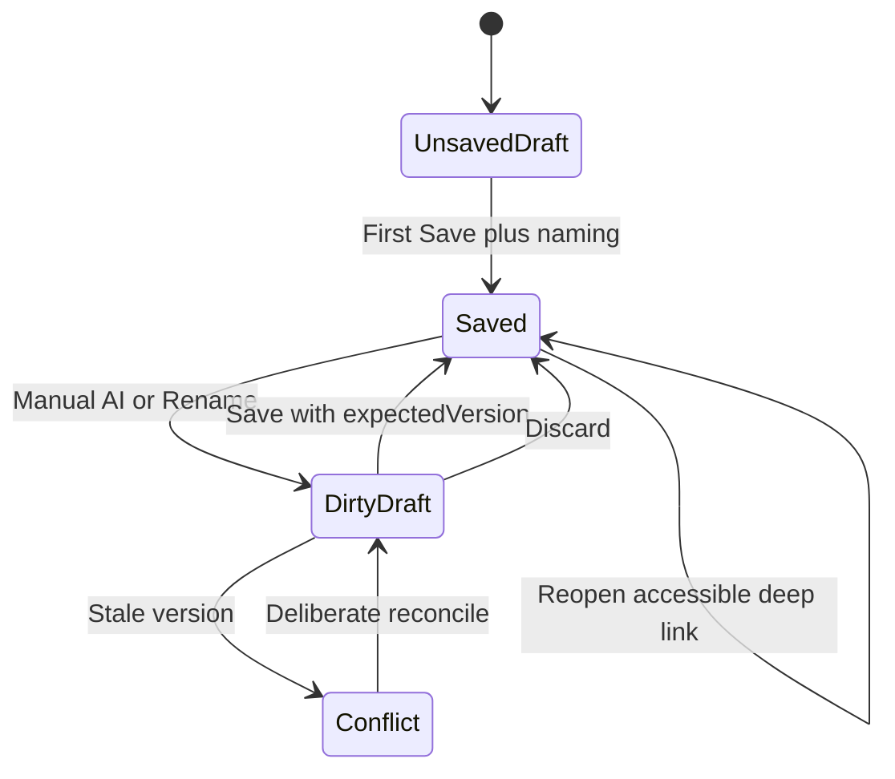

## 11. Library and folders

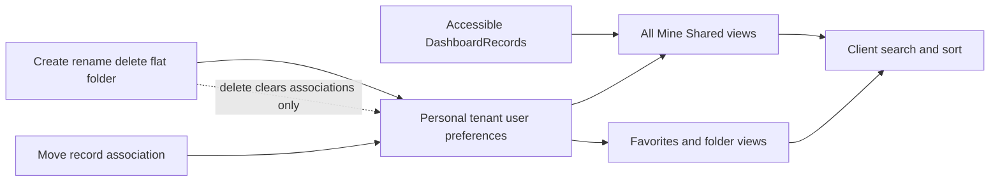

## 12. Theme and presentation

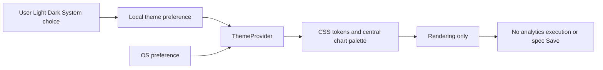

## 13. Proposed real-data target — pending confirmation

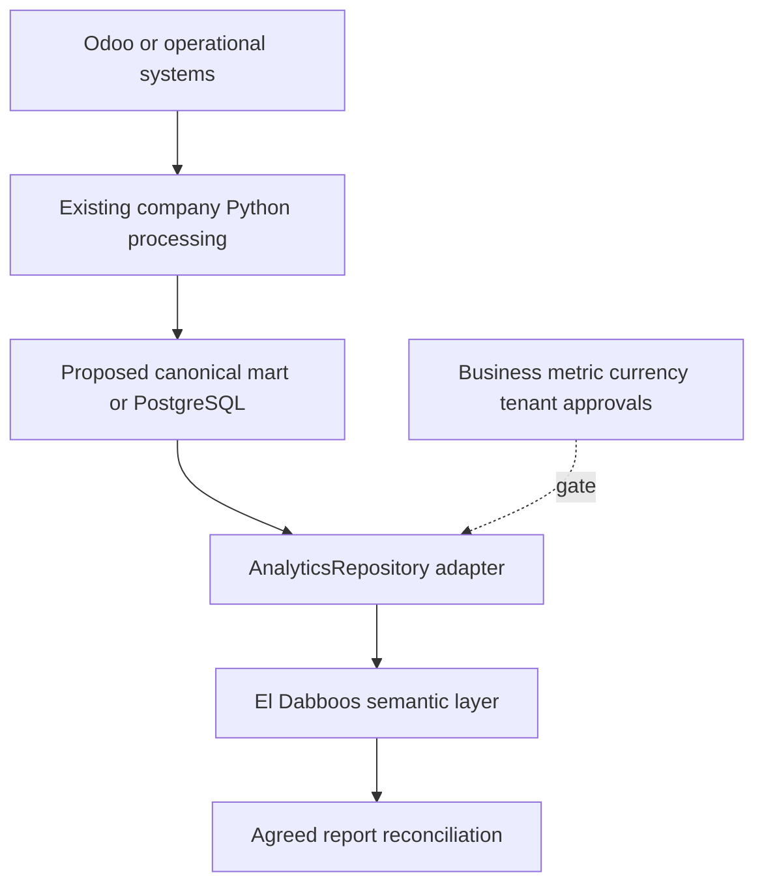

## 14. Proposed production request tracing — design only

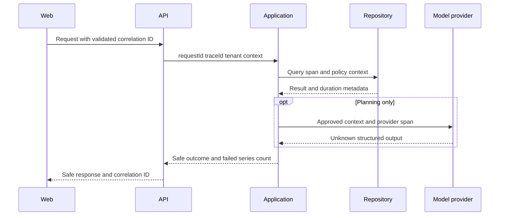
