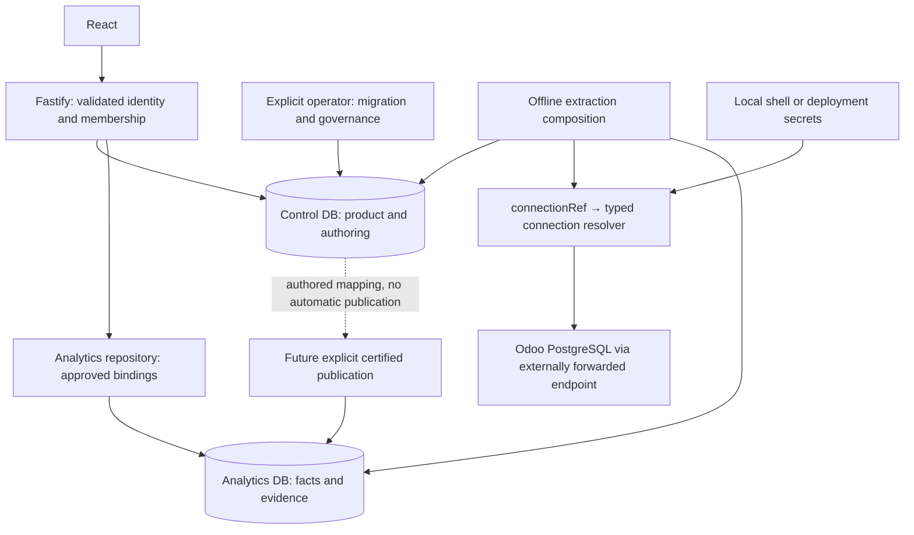

# PostgreSQL control plane and shared staging

The control database owns product configuration and administration. The Analytics mart owns immutable facts, ingestion/extraction/reconciliation evidence, published mapping releases and serving bindings. An approved mart binding remains the data-serving authority; dashboard queries never discover source connections or authoring mappings dynamically.

Local PostgreSQL 18.6 uses the existing persistent container at `127.0.0.1:55437`: `el_dabboos_control` and `el_dabboos_analytics` are separate databases. The persistent volume and Analytics mart roles/migrations/data are retained. The disposable synthetic test server at port 55436 has its existing configuration. Shared staging will use `el_dabboos_control_staging` and `el_dabboos_analytics_staging`; production later requires separate production infrastructure, credentials and backups. Neither environment is deployed by this milestone.



The local interactive companion depicts the shared staging target; its publication path remains future operator work. The Mermaid source above is the canonical documentation diagram.

## Storage and identity

`CONTROL_PROVIDER=sqlite` retains local/demo metadata compatibility. `CONTROL_PROVIDER=postgres` requires `CONTROL_DATABASE_URL`; `CONTROL_POOL_MAX` defaults to 8. `CONTROL_MIGRATOR_URL` is operator-only. PostgreSQL mode never opens `dashboards.db`; administration, access resolution, dashboards and library all use `PostgresAdministrationStore` through existing domain unit-of-work ports. SQLite and PostgreSQL share administration repositories and business validation. PostgreSQL reads retain a repeatable-read snapshot; writes serialize administration decisions with a database advisory transaction lock. Spec/access updates share the existing optimistic version token. Library folder deletion and preference detachment are atomic.

`demo.db` remains local synthetic analytics only; it is never imported into production PostgreSQL. `dashboards.db` remains local/dev compatibility and a one-time migration source, rather than a permanent production authority. No dual-write service exists.

The NOLOGIN groups `control_migrator` and `control_app` have dedicated local identities `control_migrator_login` and `control_app_login`. The control database is owned by `control_migrator`. PUBLIC has no database connection or public-schema creation grants. Mart runtime/ingestor groups have no control grants or membership. The app is non-superuser, has no BYPASSRLS, database/role creation, schema DDL, migration-history write, audit update/delete or mapping approval/publication privileges. Runtime checks reject elevated or overlapping identities. Migration history is SELECT-only for app readiness verification. This milestone retains application-owned tenant predicates and membership authorization; it does not add control-plane RLS or promise protection against a compromised application login.

Synthetic identity is local/demo only. PostgreSQL control configuration rejects `ACCESS_IDENTITY_MODE=synthetic` and defaults to disabled authentication. Requests fail closed in disabled mode; the [local session adapter](../security/local-authentication.md) now supports governed provisioning with separate auth-owned control storage. The existing `IdentityBinding` uses a configured issuer/provider plus stable subject; email/loginHint is optional display metadata. No Odoo-password endpoint, OAuth, LDAP or SSO is implemented.

## Local provisioning and migrations

Set distinct generated `CONTROL_LOCAL_MIGRATOR_PASSWORD` and `CONTROL_LOCAL_APP_PASSWORD` in ignored `.env.local`, each at least 24 characters, alongside the existing `MART_LOCAL_ADMIN_PASSWORD`. Set the two control URLs with their dedicated identities and `/el_dabboos_control`. The runtime URL must never equal an operator/mart URL. Startup also checks PostgreSQL role memberships and privileges, rather than relying on URL usernames alone.

```bash
pnpm mart:local up
pnpm control bootstrap-local
pnpm control migrate
pnpm control verify
```

Bootstrap creates only the missing control database, verifies its existing owner and provisions only control identities. It never recreates the Analytics database or modifies mart roles. Repeat bootstrap with the same approved credentials is safe. No Docker volume reset or second persistent PostgreSQL server is required. Secret-bearing errors/URLs are not printed. Operator CLI errors deliberately provide a bounded failure message; use approved local diagnostics without pasting credentials or raw source rows.

Numbered control migrations under `packages/data/migrations/control`:

1. `001_metadata.sql`: product/administration tables, exact-text dashboard JSON, FK and uniqueness/version constraints.
2. `002_governance.sql`: ownership immutability, role/grant plane guards, audit immutability and app grants.
3. `003_sources.sql`: source definitions/company scope and governed mapping authoring/lifecycle metadata.
4. `004_candidate_guards.sql`: frozen mapping child configuration once a draft becomes a candidate.
5. `005_mapping_lifecycle_audit.sql`: immutable lifecycle events with database actor, timestamp and evidence reference.

Each migration and its ledger insertion run in one transaction under an advisory migration lock; failure rolls back that migration. The loader requires contiguous numbered files. History names/checksums must match; gaps, tampering and newer schemas fail closed. API startup/readiness requires the exact current manifest. Constructors never migrate or seed. Migrations already applied must never be edited: add a new migration. The ledger bootstrap is infrastructure outside an individual migration transaction, matching mart discipline; a failed first migration can leave an empty ledger but no product schema.

## Controlled SQLite cutover

Take and approve a consistent source backup. Bring that backup through the existing explicit SQLite metadata migrations, including any required ownership reconciliation. Do not silently create identities, tenants or permissions to repair old data. Stop metadata writes for the cutover, then:

```bash
pnpm control import-sqlite /absolute/path/approved-dashboards.db --dry-run
pnpm control import-sqlite /absolute/path/approved-dashboards.db
```

The source is read-only with one retained SQLite transaction. Integrity/FKs, exact known schema and current migration history are required. Dashboard JSON must pass canonical/semantic validation but is inserted as its exact original text. Target schema must be current and its imported tables empty. Unknown/corrupt data, orphan personal metadata, constraint failure and any changed row fail the complete transaction. IDs, versions, timestamps, identity subject bindings, memberships, permissions, role domains, scopes, grants, folders/preferences, bootstrap/candidate state and audits are preserved. Verification compares every column of every source/target row and reports counts and primary-key column names; PostgreSQL enforces and validates FKs before commit. Dry-run runs the same copy/verification then rolls back. No source data is changed, and reruns into a populated target fail.

After approval of parity and operational backup/restore evidence, select PostgreSQL and make it the sole authority. Keep the source backup for the agreed recovery window; do not resume writes to it. Rollback of an authority cutover requires an explicit operational decision, not automatic fallback.

The current local root `dashboards.db` is a legacy three-table library file without administration history. Its dry-run fails closed. It has not been upgraded, reconciled or imported by this task. Local control schema/credentials are ready, but product data remains empty until an approved source or explicit trusted bootstrap is supplied.

## Sources, scopes and secrets

A source definition stores `sourceId`, `tenantId`, governed type `odoo-postgres`, `enabled`, opaque `connectionRef` and explicit company IDs. Source IDs are globally unique; `(tenantId,sourceId)` ownership/FKs prevent cross-tenant scope references. One tenant can own multiple sources. Empty/duplicate/invalid company scope and duplicate source IDs are rejected. An unknown or disabled connection fails closed.

The staging source can be represented as operator input (metadata only):

```json
{"tenantId":"el-dabboos-iq","sourceId":"el-dabboos-odoo18-pg","type":"odoo-postgres","companyIds":["1"],"connectionRef":"odoo-staging-main","enabled":true}
```

Its tenant must already be governed/provisioned. `pnpm control source-create /approved/source-definition.json` validates the complete shape and stores it transactionally; it does not connect to Odoo or ingest/approve/publish data. In PostgreSQL control mode, offline pilot run composition resolves its source through this repository. The existing pilot manifest continues to identify its immutable mapping/evidence; local SQLite compatibility retains the legacy explicit environment configuration. No pilot extraction was rerun for this task.

`SourceConnectionResolver` maps a reference to a typed PostgreSQL connection. The local composition maps `odoo-staging-main` to `ODOO_SOURCE_*` shell/`.env.local` values, using database-owned company scope. Multiple typed reference entries are supported; unknown references never use a fallback connection. Future deployment composition can supply a secret-manager-backed registry without exposing environment maps to application/domain. The Odoo adapter receives typed config and never reads `process.env`. No credentials, credential-bearing URLs or SSH fields are stored in control metadata. SSH/tunnels remain external; the adapter only sees the already-forwarded PostgreSQL endpoint. Staging/production secrets belong to deployment secret storage or a secret manager; secrets stay outside committed metadata and default logs.

## Mapping governance and publication

`source_mappings` owns immutable versioned definitions: source/tenant/dataset identity, business basis, reporting currency, owner, and the governed `odoo-comparison-v1` recipe. Measure and dimension child tables select closed adapter capabilities. The recipe owns source objects, header grain, recognition/states, amount/sign/currency and stable dimension attribution; these are not arbitrary executable SQL/JavaScript or expressions. Authoring selection does not itself change adapter execution or certify a new metric.

Definitions start as `draft`. Explicit operator transitions permit only `draft → candidate → reconciled → approved → published`; reconciled/approved/published require opaque evidence references. Definition identity/business basis is immutable; child inserts stop at candidate, and updates/deletes are rejected. Database triggers append immutable lifecycle evidence recording the actual login and timestamp. API app credentials can create/read drafts but cannot transition them or fabricate lifecycle events.

These control statuses are governance metadata, never proof of certification or serving authority. A future explicit publication use case must verify reconciliation/business approval, compile the selected recipe into a canonical validated `SourceMapping`, publish an immutable release using the existing mart safety model, and separately authorize a binding. Cross-database publication/recovery and business approval workflows remain unimplemented. No lifecycle command automatically approves or publishes; this task leaves the existing September mapping v1 pending and serving bindings zero.

## Remaining shared staging gates

Reviewed employee authentication rollout and future IdP selection/adapters; approved metadata backup/cutover; source/business ownership and Odoo Invoice Analysis gross/refund/filter certification; explicit certified publication/recovery use case; deployment secrets, TLS/origin/session policy; encrypted backups/restore drills; resource/pool/concurrency sizing and operational observability. React/Fastify will use the two staging databases and staging-only secrets/Odoo endpoint. Production repeats the boundaries on separate resources. Scheduled sync, backfill, hard-delete reconciliation, production integration and shared deployment are outside this milestone.
