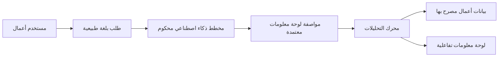
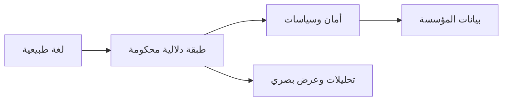
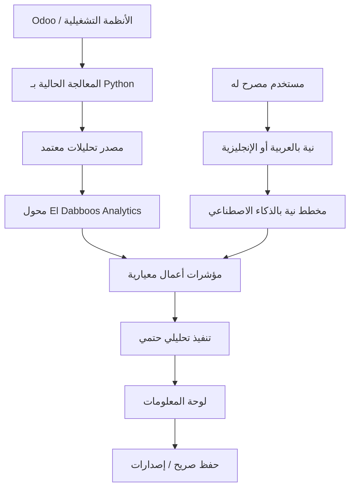
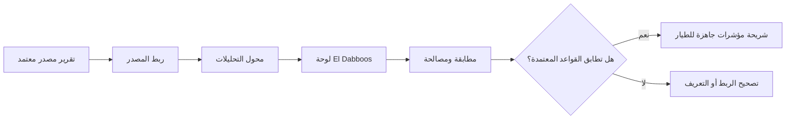
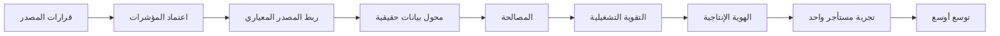

# El Dabboos Analytics — العرض الإداري

> المرحلة الأولى: الانتقال من نموذج أولي إلى تحليلات إنتاجية محكومة

---

# 1. ما هو El Dabboos Analytics؟

El Dabboos Analytics هو **طبقة منتج تحليلات تبدأ من الذكاء الاصطناعي** لبيانات التشغيل الخاصة بـ El Dabboos.

وهو يتيح للمستخدم المصرح له:

- طلب لوحة معلومات بلغة طبيعية،
- الحصول على لوحة محكومة مبنية على مؤشرات أعمال معتمدة،
- تخصيصها يدوياً،
- حفظها وإعادة فتحها،
- العمل بالعربية أو الإنجليزية،
- البقاء ضمن صلاحيات المستأجر والشركة والفرع والدور الخاص بالمستخدم.

الذكاء الاصطناعي **لا يستعلم مباشرة من قواعد البيانات ولا يخترع منطق الأعمال**.

---

# 2. ما المشكلة التي يحلها؟

التقارير التقليدية تخلق اعتماداً متكرراً:

El Dabboos Analytics يحول هذا المسار إلى:

الهدف ليس الاستغناء عن المحللين أو مالكي المجال.

الهدف هو إزالة العمل المتكرر في بناء لوحات المعلومات مع إبقاء **تعريفات الأعمال والأمان وملكية البيانات تحت السيطرة**.

---

# 3. قيمة النظام للأعمال

## وصول أسرع للمعلومة

يمكن لمستخدم الأعمال الانتقال من سؤال إلى لوحة قابلة للاستخدام دون انتظار دورة تطوير جديدة.

## أرقام متسقة

الإيرادات والطلبات والهوامش ومؤشرات الصيانة وغيرها من مؤشرات الأداء تأتي من تعريف دلالي محكوم واحد، بدلاً من إعادة حسابها بصورة مختلفة في كل تقرير.

## قدرة منتج قابلة لإعادة الاستخدام

يمكن لنفس منصة التحليلات أن تخدم عدة عملاء وأسواق لـ El Dabboos مع إبقاء بيانات كل مستأجر معزولة.

## تقليل تكلفة صيانة التقارير

لوحات المعلومات تصبح مواصفات مبنية على مؤشرات محكومة، وليست تقارير SQL أو شيفرة مخصصة لكل حالة.

## استخدام الذكاء الاصطناعي دون منحه السيطرة على منصة البيانات

النموذج يفسر النية؛ بينما البرمجيات الحتمية تملك الأمان، وتعريفات المؤشرات، والتحقق، وقواعد التخطيط، والتنفيذ.

---

# 4. لماذا هذا نمط مؤسسي وليس تجربة؟

كبار موردي التحليلات يتحركون في نفس الاتجاه العام:

| المنتج المؤسسي | النمط المرتبط |
| --- | --- |
| **Microsoft Power BI Copilot** | تحليلات بلغة طبيعية فوق نماذج دلالية مجهزة مسبقاً |
| **ThoughtSpot Spotter** | تحليلات حوارية مبنية على طبقة دلالية محكومة |
| **Tableau Agent** | استكشاف وعرض بصري باللغة الطبيعية مع حوكمة مؤسسية |
| **Qlik Answers** | إجابة وكيلية على الأسئلة فوق مصادر مهيأة ومنظمة وغير منظمة |

الاتجاه العام واضح:

El Dabboos يطبق هذا النمط مباشرة على مجاله التشغيلي، بدلاً من جعل أداة BI خارجية عامة هي المنتج نفسه.

---

# 5. ما الذي يميز منهج El Dabboos؟

القيمة الاستراتيجية ليست ببساطة أن "الذكاء الاصطناعي يستطيع رسم مخططات".

المنتج يجمع بين:

- مؤشرات أعمال El Dabboos والمعرفة التشغيلية،
- التكامل المباشر مع منظومة Odoo / Python / PostgreSQL الحالية،
- تجربة استخدام ثنائية اللغة بالعربية والإنجليزية،
- وعي بسوقي العراق ومصر،
- تعدد المستأجرين وصلاحيات على مستوى الفروع،
- إنشاء لوحات يدوياً وبالذكاء الاصطناعي داخل مسار واحد،
- استقلالية مزود الذكاء الاصطناعي، بما في ذلك النماذج المحلية أو المستضافة داخل الشركة،
- حفظ محكوم وإصدارات وقابلية للتدقيق مستقبلاً.

هذا يصنع **قدرة تحليلات مدمجة ومملوكة لـ El Dabboos**.

---

# 6. سير العمل عالي المستوى

الذكاء الاصطناعي عنصر واحد فقط ضمن المسار.

أما الطبقات الحساسة للأعمال فتظل حتمية ومحكومة.

---

# 7. ما الذي يعمل بالفعل؟

الأساس الحالي للمنتج يتضمن بالفعل:

- توليد لوحات بالذكاء الاصطناعي وتعديلها بالذكاء الاصطناعي،
- منشئ لوحات يدوي،
- سحب وتغيير الحجم،
- أنواع مخططات ولوحات ألوان محكومة،
- Undo / Redo،
- العربية والإنجليزية وRTL،
- صلاحيات تجريبية متعددة المستأجرين،
- مؤشرات دلالية وحسابات مشتقة،
- تحقق حتمي،
- لوحات محفوظة ومعالجة تعارضات الإصدارات،
- تكامل آمن مع مزود متوافق مع OpenAI،
- تحقق حي ناجح لنموذج Bonsai المحلي.

المرحلة الحالية لديها **430 اختباراً آلياً ناجحاً**.

المرحلة التالية ليست أساساً مرحلة نموذج UX أولي.

بل هي **مرحلة بيانات حقيقية وجاهزية للإنتاج**.

---

# 8. الهدف الإداري للمرحلة الأولى

## إثبات مسار رأسي حقيقي واحد من البداية للنهاية

النطاق الأول المقترح:

**مستأجر واحد معتمد + المبيعات + شهر مغلق واحد**

المؤشرات:

- الإيرادات
- صافي الإيرادات
- عدد الطلبات

العروض:

- شهري،
- حسب الفرع.

والقبول يتطلب:

---

# 9. القرارات المطلوبة من المالكين التقنيين ومالكي الأعمال

قبل تفعيل بيانات عملاء حقيقية، تحتاج المرحلة الأولى إلى اتفاق على:

1. **مصدر التحليلات المعتمد**  
   مستودع PostgreSQL، قاعدة بيانات مطبعة، API، نسخة قراءة، أو مصدر آخر معتمد.

2. **تعريفات المؤشرات**  
   ما الذي يُحتسب تحديداً ضمن الإيراد وصافي الإيراد والطلبات والمرتجعات والخصومات والضرائب والحالات المؤهلة.

3. **ربط المستأجر / الشركة / الفرع**  
   كيف يتم ربط شركات وفروع Odoo بمستأجري Analytics والصلاحيات.

4. **سياسة العملة**  
   عملة المعاملة، والعملة الأساسية، وعملة التقارير؛ ومن يملك التحويل ومتى يتم.

5. **حداثة البيانات والتصحيحات**  
   العلامات الزمنية، والتحديثات، والـ backfills، والحذف، والمصالحة.

6. **الهوية الإنتاجية**  
   أي نظام يقوم بالمصادقة ويزودنا بالعضويات والصلاحيات.

7. **سياسة خصوصية الذكاء الاصطناعي**  
   أي prompts أو عناوين أو معرفات فروع/عملاء/منتجات يمكن إرسالها لكل نوع نشر للنموذج.

---

# 10. التحكم في المخاطر

التصميم يمنع عمداً عدة أنماط عالية الخطورة.

| الخطر | التحكم |
| --- | --- |
| الذكاء الاصطناعي يخترع SQL | الذكاء الاصطناعي لا يكتب SQL |
| تسريب بين العملاء | يتم فرض المستأجر والسياسات قبل التنفيذ |
| معادلة KPI خاطئة | المؤشرات موجودة في تعريفات دلالية محكومة |
| الذكاء الاصطناعي ينشئ لوحات عشوائية | يجب أن يجتاز الخرج schemas صارمة والتحقق الدلالي |
| الذكاء الاصطناعي يغير الأمان | سياسة الأمان خارج مواصفات لوحة المعلومات |
| العملات المختلطة تنتج إجماليات خاطئة | المحول الإنتاجي يفشل بشكل مغلق حتى اعتماد قواعد العملة |
| مزود الذكاء الاصطناعي يرى بيانات عميل بدون قصد | سياسة تصدير سياق خاصة بكل مزود قبل استخدام البيانات الحقيقية |
| تعديلات صامتة تكتب فوق العمل المحفوظ | Save صريح + معالجة تعارض الإصدار بطريقة optimistic versioning |

---

# 11. مسار تسليم المرحلة الأولى

يجب أن نتجنب عمداً التوسع الواسع قبل مطابقة واعتماد أول عائلة من المؤشرات.

---

# 12. كيف يبدو النجاح؟

تكون المرحلة الأولى ناجحة عندما يستطيع مستخدم تجريبي مصرح له:

1. تسجيل الدخول باستخدام الهوية الإنتاجية المعتمدة،
2. الوصول فقط إلى بيانات المستأجر / الفرع المسموح له بها،
3. طلب لوحة مبيعات بالعربية أو الإنجليزية،
4. الحصول على Revenue / Net Revenue / Order Count من المصدر المعتمد،
5. مطابقة هذه القيم مع تقرير الأعمال الرسمي،
6. رؤية واضحة لحداثة البيانات وتوقيت المصدر،
7. تعديل اللوحة وحفظها بأمان،
8. استخدام نشر الذكاء الاصطناعي المعتمد دون مخالفة سياسة بيانات العملاء.

عندها نكون قد انتقلنا من **نموذج أولي لتحليلات بالذكاء الاصطناعي** إلى **أساس موثوق لمنصة تحليلات إنتاجية**.

---

# النتيجة المطلوبة من النقاش

في النقاش الإداري، النتيجة الأساسية المطلوبة هي اعتماد:

- أول مستأجر تجريبي،
- أول تقرير مبيعات رسمي / شهر مغلق،
- مالكي الأعمال الذين يعتمدون تعريفات المؤشرات ونسب التفاوت المقبولة،
- مالك نظام المصدر،
- مالك الهوية الإنتاجية،
- مالك سياسة العملة،
- مالك سياسة خصوصية ونشر الذكاء الاصطناعي.

يجب أن يأتي التنفيذ بعد هذه القرارات، لا أن يفترضها.

---

# مراجع مؤسسية

- Microsoft Learn — *Use Copilot with semantic models in Power BI*  
  https://learn.microsoft.com/power-bi/create-reports/copilot-semantic-models
- Microsoft Learn — *Copilot for Power BI overview*  
  https://learn.microsoft.com/power-bi/create-reports/copilot-introduction
- ThoughtSpot — *Spotter*  
  https://www.thoughtspot.com/product/agents/spotter
- Tableau — *Tableau Agent*  
  https://www.tableau.com/products/tableau-agent
- Qlik Help — *Qlik Answers*  
  https://help.qlik.com/en-US/cloud-services/Subsystems/Hub/Content/Sense_Hub/QlikAnswers/Qlik-Answers.htm

---

# مراجع المعمارية الداخلية

- `docs/architecture/system-design.md`
- `docs/architecture/source-integration.md`
- `docs/integration/production-readiness.md`
- `docs/integration/questions-for-malik.md`
- `docs/integration/real-data-contract.md`
- `docs/integration/reconciliation-plan.md`
