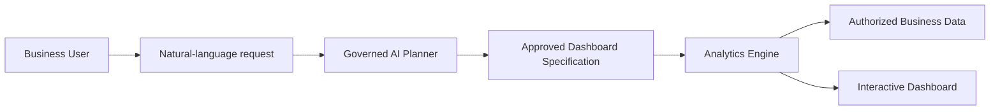
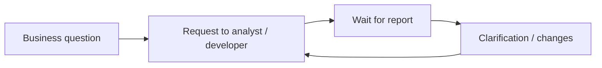
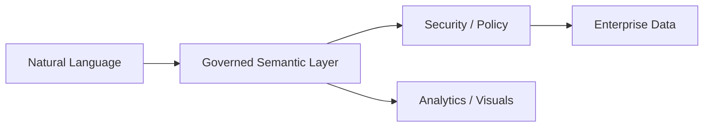
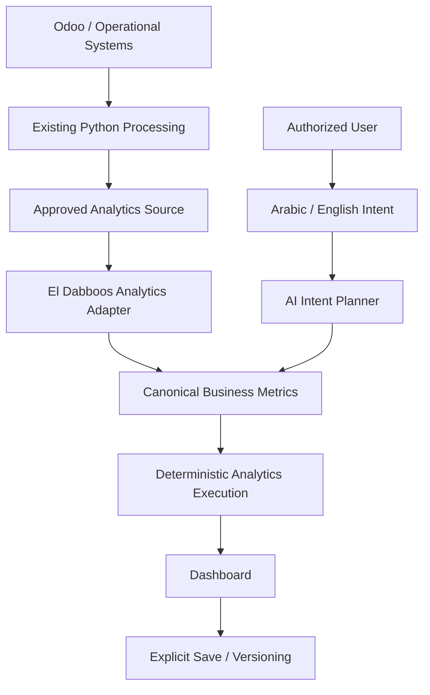
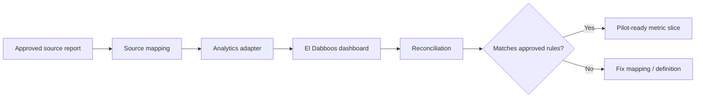

# El Dabboos Analytics — Management Presentation

> Phase 1: From prototype to governed production analytics

---

# 1. What is El Dabboos Analytics?

El Dabboos Analytics is an **AI-first analytics product layer** for El Dabboos operational data.

It lets an authorized business user:

- ask for a dashboard in natural language,
- receive a governed dashboard built from approved business metrics,
- customize it manually,
- save and reopen it,
- work in English or Arabic,
- stay inside the user's tenant, company, branch, and role permissions.

The AI does **not** directly query databases or invent business logic.

---

# 2. What problem does it solve?

Traditional reporting creates a repeated dependency:

El Dabboos Analytics changes this into:

The goal is not to remove analysts or domain owners.

The goal is to remove repetitive dashboard-building work while keeping **business definitions, security, and data ownership controlled**.

---

# 3. Business value

## Faster access to information

Business users can move from a question to a usable dashboard without waiting for a new development cycle.

## Consistent numbers

Revenue, orders, margins, maintenance metrics, and other KPIs come from one governed semantic definition instead of being recalculated differently in each report.

## Reusable product capability

The same analytics platform can serve multiple El Dabboos customers and markets while keeping tenant data isolated.

## Lower reporting maintenance

Dashboards are specifications over governed metrics, not one-off code or SQL reports.

## AI without giving AI control of the data platform

The model interprets intent; deterministic software owns security, metric definitions, validation, layout rules, and execution.

---

# 4. Why this is an enterprise pattern, not an experiment

Large analytics vendors are moving toward the same broad model:

| Enterprise product | Relevant pattern |
| --- | --- |
| **Microsoft Power BI Copilot** | Natural-language analytics over prepared semantic models |
| **ThoughtSpot Spotter** | Conversational analytics grounded in a governed semantic layer |
| **Tableau Agent** | Natural-language exploration and visualization with enterprise governance |
| **Qlik Answers** | Agentic question answering over curated structured and unstructured sources |

The industry direction is clear:

El Dabboos is applying this pattern directly to its own operational domain instead of introducing a generic external BI experience as the product itself.

---

# 5. What is different about the El Dabboos approach?

The strategic value is not simply "AI can draw charts."

The product combines:

- El Dabboos business metrics and operational knowledge,
- direct fit with the existing Odoo / Python / PostgreSQL ecosystem,
- bilingual English / Arabic UX,
- Iraq and Egypt market awareness,
- multi-tenant and branch-level authorization,
- manual and AI dashboard creation in one workflow,
- provider-neutral AI, including company-hosted/local models,
- controlled persistence, versioning, and future auditability.

This creates an **embedded analytics capability owned by El Dabboos**.

---

# 6. High-level workflow

The AI is only one component of the workflow.

The business-critical layers remain deterministic and controlled.

---

# 7. What is already working?

The current product foundation already includes:

- AI dashboard generation and AI editing,
- manual dashboard builder,
- drag / resize,
- governed chart types and palettes,
- Undo / Redo,
- English / Arabic and RTL,
- multi-tenant demo authorization,
- semantic metrics and derived calculations,
- deterministic validation,
- saved dashboards and version conflicts,
- safe OpenAI-compatible provider integration,
- successful local Bonsai model validation.

The current milestone has **430 automated tests passing**.

The next phase is not primarily a UX prototype phase.

It is a **real-data and production-readiness phase**.

---

# 8. Phase 1 management objective

## Prove one real vertical slice end-to-end

Recommended first scope:

**One approved tenant + Sales + one closed month**

Metrics:

- Revenue
- Net Revenue
- Order Count

Views:

- monthly,
- by branch.

Acceptance requires:

---

# 9. Decisions needed from technical and business owners

Before real customer data is enabled, Phase 1 needs agreement on:

1. **Authoritative analytics source**  
   PostgreSQL mart, normalized database, API, replica, or another approved source.

2. **Metric definitions**  
   What exactly counts as revenue, net revenue, orders, returns, discounts, tax, and eligible states.

3. **Tenant / company / branch mapping**  
   How Odoo companies and branches map to Analytics tenants and permissions.

4. **Currency policy**  
   Transaction, base, and reporting currency; conversion ownership and timing.

5. **Data freshness and corrections**  
   Watermarks, updates, backfills, deletes, and reconciliation.

6. **Production identity**  
   Which system authenticates users and supplies memberships / permissions.

7. **AI privacy policy**  
   Which prompts, titles, branch/customer/product identifiers may be sent to each model deployment.

---

# 10. Risk control

The design intentionally prevents several high-risk patterns.

| Risk | Control |
| --- | --- |
| AI invents SQL | AI never writes SQL |
| Cross-customer leakage | Tenant and policy context enforced before execution |
| Wrong KPI formula | Metrics live in governed semantic definitions |
| AI creates arbitrary dashboards | Output must pass strict schemas and semantic validation |
| AI changes security | Security policy is outside dashboard specifications |
| Mixed currencies produce false totals | Production adapter must fail closed until currency rules are approved |
| AI provider sees customer data unexpectedly | Provider-specific context/export policy before real-data use |
| Silent edits overwrite saved work | Explicit Save + optimistic version conflict handling |

---

# 11. Phase 1 delivery path

We should deliberately avoid broad rollout before the first metric family is reconciled.

---

# 12. What success looks like

Phase 1 is successful when an authorized pilot user can:

1. sign in using the approved production identity,
2. access only their permitted tenant / branch data,
3. ask for a Sales dashboard in English or Arabic,
4. receive Revenue / Net Revenue / Order Count from the approved source,
5. reconcile those values with the official business report,
6. see clear freshness / source timing,
7. edit and save the dashboard safely,
8. use the approved AI deployment without violating customer-data policy.

At that point we have moved from **AI analytics prototype** to a credible **production analytics platform foundation**.

---

# Discussion outcome requested

For the management discussion, the key outcome is approval of:

- the first pilot tenant,
- the first authoritative Sales report / closed month,
- the business owners who sign metric definitions and tolerances,
- the source-system owner,
- the production identity owner,
- the currency owner,
- the AI privacy / deployment policy owner.

Implementation should follow those decisions rather than infer them.

---

# Enterprise references

- Microsoft Learn — *Use Copilot with semantic models in Power BI*  
  https://learn.microsoft.com/power-bi/create-reports/copilot-semantic-models
- Microsoft Learn — *Copilot for Power BI overview*  
  https://learn.microsoft.com/power-bi/create-reports/copilot-introduction
- ThoughtSpot — *Spotter*  
  https://www.thoughtspot.com/product/agents/spotter
- Tableau — *Tableau Agent*  
  https://www.tableau.com/products/tableau-agent
- Qlik Help — *Qlik Answers*  
  https://help.qlik.com/en-US/cloud-services/Subsystems/Hub/Content/Sense_Hub/QlikAnswers/Qlik-Answers.htm

---

# Internal architecture references

- `docs/architecture/system-design.md`
- `docs/architecture/source-integration.md`
- `docs/integration/production-readiness.md`
- `docs/integration/questions-for-malik.md`
- `docs/integration/real-data-contract.md`
- `docs/integration/reconciliation-plan.md`
