# El Dabboos Analytics — العرض التقني

> المرحلة الأولى: تكامل البيانات الحقيقية ومعمارية الجاهزية للإنتاج

---

# 1. النظام الحالي

El Dabboos Analytics هو منصة تحليلات محكومة ومتعددة المستأجرين، وتتكون من:

- تطبيق ويب بـ React،
- Fastify API،
- حالات استخدام ومخططات داخل طبقة التطبيق،
- عقود Domain مستقلة عن مصدر البيانات،
- محرك تحليلات حتمي،
- repository adapters قابلة للاستبدال،
- تكامل structured LLM متوافق مع OpenAI،
- تجربة استخدام ثنائية اللغة EN / AR،
- حفظ لوحات بإصدارات.

حد الإنتاج الحالي:

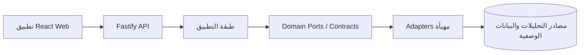

اتجاه الاعتماد أثناء البناء يظل للداخل باتجاه الـ Domain.

---

# 2. القاعدة المعمارية الأساسية

اللغة الطبيعية لا تتحول مباشرة إلى بنية تحتية قابلة للتنفيذ.

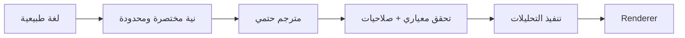

الـ LLM لا يكتب:

- SQL،
- React،
- ألوان خام،
- إعدادات charts عشوائية،
- فلاتر صلاحيات،
- سياسات المستأجر،
- معرفات قواعد البيانات.

ويتم التعامل مع زمن استجابة الـ LLM كقيد منتجي.

---

# 3. عقود التطبيق الحالية

الحد المستقر المهم مع مصدر البيانات هو:

```ts
interface AnalyticsRepository {
  execute(
    query: AnalyticsQuery,
    context: AnalyticsContext
  ): Promise<AnalyticsResult>;
}
```

`AnalyticsContext` يحتوي فقط على قيود التنفيذ التي تم حلها مسبقاً:

```ts
{
  tenantId,
  locale,
  enforcedFilters
}
```

الـ repository لا يحتاج user objects أو roles أو emails أو access tokens أو UI state.

يجب أن يبقى هذا الـ port كما هو ما لم تثبت بيانات المصدر الحقيقي وجود قدرة ناقصة.

---

# 4. مسار البيانات الحالي مقابل الإنتاج

## النموذج الحالي

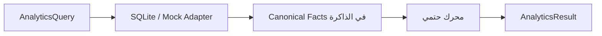

هذا مناسب للتحقق الحتمي واختبارات العقود.

لكنه **ليس دليلاً على قابلية التنفيذ على حجم إنتاجي**، لأن SQLite حالياً يحمل المقاييس المتعلقة بالمستأجر إلى الذاكرة.

## الهدف الإنتاجي

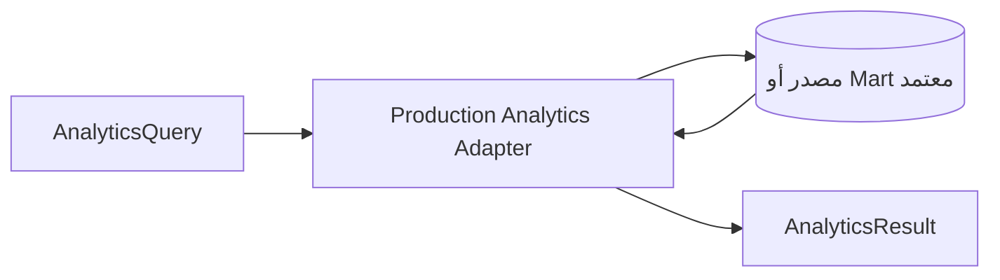

يجب دفع الفلترة والتجميع وحدود المصدر والإلغاء نحو المصدر الإنتاجي عندما يكون ذلك مناسباً.

---

# 5. تكامل المصدر المقترح

الهيكل الأكثر احتمالاً:

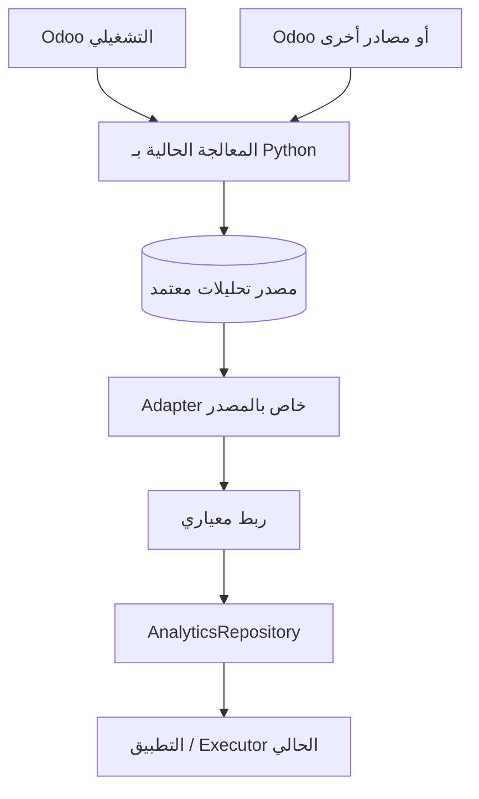

لكن **المصدر ما زال قراراً، وليس افتراضاً**.

تنفيذات adapter المحتملة:

- `PostgresAnalyticsRepository`
- adapter لـ API معتمد،
- adapter يعتمد على replica،
- adapter لمستودع بيانات مملوك للشركة.

لا ينبغي أن نكتب repository خاصاً بـ Odoo قبل أن يؤكد Malik عقد المصدر الحقيقي.

---

# 6. الربط المعياري للمصدر

الطبقة الدلالية في الـ Domain تملك semantics المؤشرات المستقلة عن المصدر.

أمثلة:

```text
revenue              -> additive source measure
order_count          -> additive source measure
average_order_value  -> revenue / order_count
gross_margin         -> gross_profit / net_revenue
win_rate             -> won / closed opportunities
```

المؤشرات المشتقة يجب أن تظل مشتقة.

إدخال الإنتاج لا يجب أن يرسل كمقاييس مستقلة قابلة للجمع:

- `average_order_value`,
- `gross_margin`,
- `sales_growth`,
- `win_rate`,
- `mtbf`,
- `mttr`.

---

# 7. غلاف المصدر الإنتاجي

النوع الداخلي الحالي `AnalyticsFact` صغير عمداً:

```text
tenantId
measureId
date
value
entityId?
dimensions
```

في التكامل الإنتاجي، سيحتاج حد الـ adapter إلى أدلة ومفاهيم إضافية مثل:

```text
stable source event identity
source revision / version
transaction currency
base currency
reporting currency
source extraction watermark
batch / revision identity
correction / deletion semantics
```

المبدأ المقترح:

> أبقِ هذه المفاهيم ضمن تكامل المصدر ما لم يثبت احتياج مشترك عبر التطبيق ضرورة توسيع عقد الـ Domain العام.

لا تجعل dashboard schema تحمل metadata خاصة بالمصدر التشغيلي.

---

# 8. أول شريحة مبيعات حقيقية

اجعل أول adapter محدوداً إلى:

- مستأجر تجريبي واحد،
- عملة تقارير واحدة معتمدة،
- شهر مغلق واحد،
- Revenue،
- Net Revenue،
- Order Count،
- تجميع شهري،
- تجميع حسب الفرع.

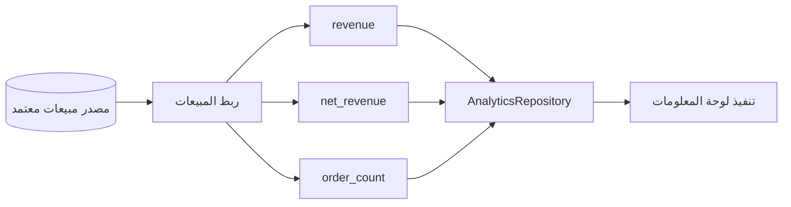

لا نبدأ بكل المجالات أو snapshot metrics أو كل سيناريوهات العملة.

---

# 9. المصالحة جزء من المعمارية

نجاح اختبارات الوحدة وحده غير كافٍ لـ adapter حقيقي.

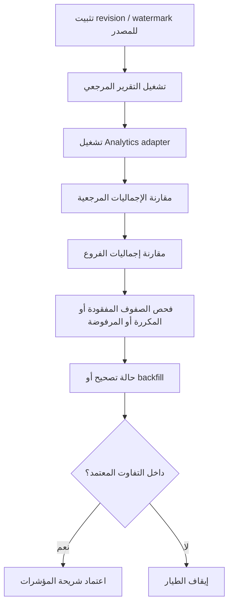

التفاوت المسموح يجب أن يأتي من مالك الأعمال.

لا ينبغي أن نخترع نسبة عامة مثل 1%.

---

# 10. هوية المستأجر / الشركة / الفرع

الربط الإنتاجي يجب أن يثبت:

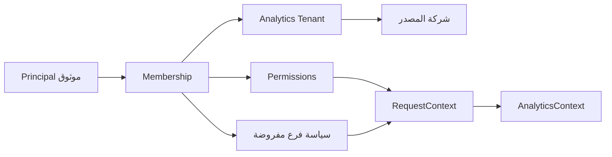

قاعدة مهمة:

**requested filters و policy filters يجب أن تظلا منفصلتين.**

قد تطلب لوحة معلومات بيانات البصرة؛ لكن مستخدم بغداد فقط لا يجب أن يرى بيانات البصرة.

الـ repository يستقبل النطاق النهائي عبر execution context الذي تم حله.

---

# 11. حد العملة

يجب حل العملة قبل تجميع القيم المالية.

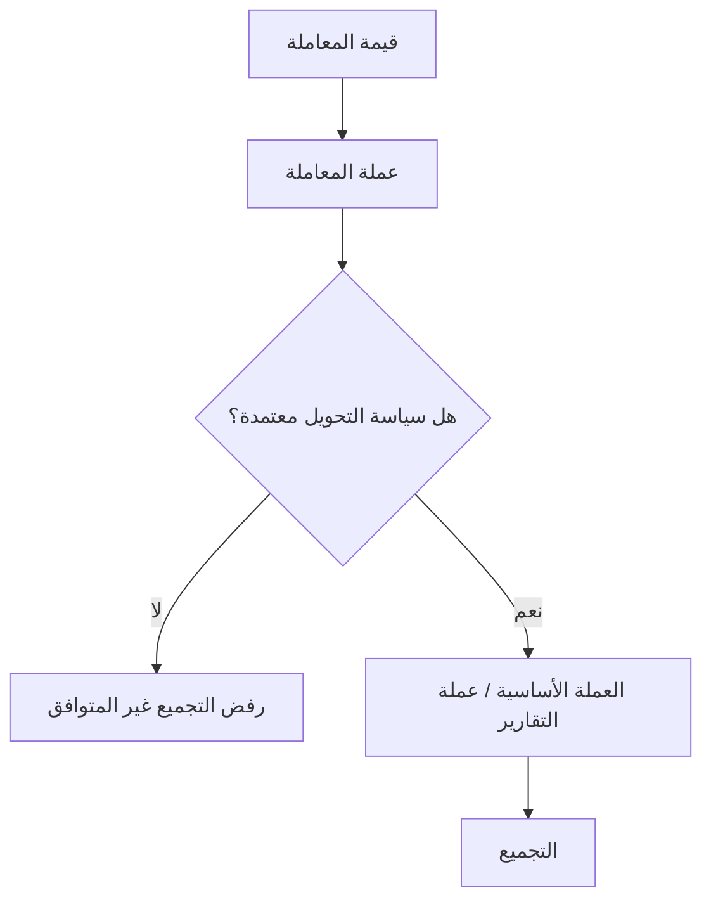

كون tenant profile التجريبي يقول `IQD` أو `EGP` هو metadata للعرض، وليس دليلاً أن كل fact تشغيلي مطبع بالفعل لهذه العملة.

يجب أن يفشل النظام بشكل مغلق عند العملة المختلطة أو غير المعروفة.

---

# 12. حداثة البيانات والتصحيحات والحذف

احتفظ بمفهومين منفصلين:

- **dataThrough** — آخر تاريخ أعمال ممثل في البيانات ذات الصلة،
- **sourceAsOf** — وقت الاستخراج أو المزامنة المعروف.

لا تستنتج أحدهما من الآخر.

ربط المصدر الإنتاجي يحتاج أيضاً إلى:

- stable source event identity،
- idempotent replay،
- قواعد backfill،
- revision handling،
- سياسة حذف / tombstone / reversal،
- قواعد اكتمال الدفعات الجزئية.

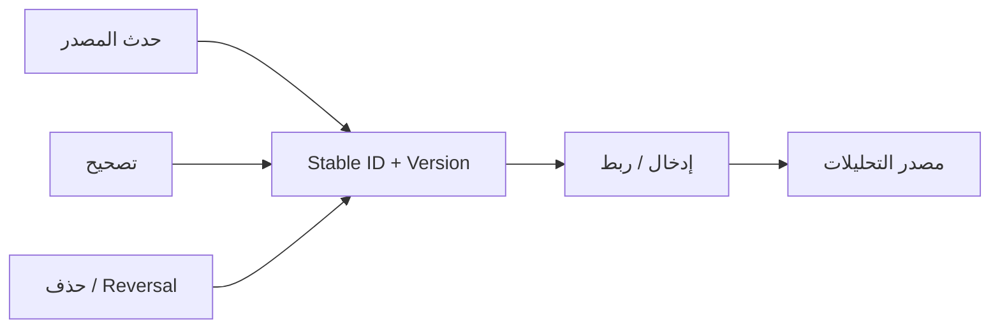

---

# 13. حد خصوصية الـ LLM

بيانات العملاء الحقيقية تغير threat model الخاص بالمخطط.

المسار الحالي يتجنب أصلاً إرسال صفوف نتائج التحليلات افتراضياً.

في الإنتاج يجب إضافة export policy خاصة بكل مزود:

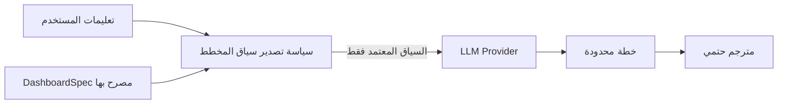

سياسة التصدير تحدد ما إذا كان المزود يمكنه استقبال:

- عناوين لوحات المعلومات،
- معرفات الفروع،
- معرفات العملاء،
- معرفات المنتجات،
- قيم الفلاتر،
- التعليمات النصية الحرة.

موافقة مزود خارجي قد تختلف عن مزود محلي أو مستضاف داخل الشركة.

ويجب أن تعيش هذه السياسة عند planner composition / provider boundary، وليس داخل `DashboardSpec`.

---

# 14. الهوية الإنتاجية

استبدل demo headers بتنفيذ حقيقي لـ IdentityProvider.

باقي التطبيق يجب أن يستمر في استهلاك نفس `RequestContext`.


الأسئلة المفتوحة:

- هل هوية Odoo هي المصدر الرسمي؟
- هل الـ Python backend يتحقق من المستخدم بالفعل؟
- هل يوجد SSO / IdP خارجي؟
- ما السرعة المطلوبة لانتشار إلغاء العضوية؟
- أي مصدر يملك صلاحيات الفروع وصلاحيات مجالات المؤشرات؟

---

# 15. متطلبات التشغيل لمصدر حقيقي

التنفيذ الحالي لكل request يوفر بالفعل:

- query normalization،
- deduplication داخل نفس request،
- bounded concurrency للاستعلامات الفريدة.

لكن الـ production adapter ما زال يحتاج:

- timeout على مستوى المصدر،
- cancellation،
- connection pooling،
- backpressure،
- تحكم في السعة على مستوى العملية،
- قواعد retry آمنة،
- source readiness probe،
- قياس latency.

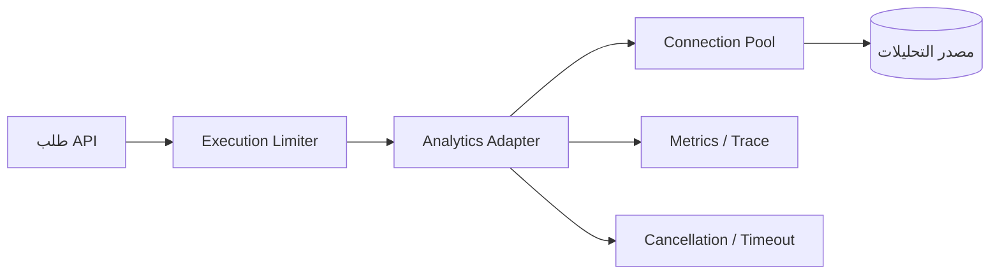

---

# 16. Observability

مسار correlation المقترح:

```text
requestId
traceId
tenantId
route
HTTP status
total latency
analytics adapter latency
LLM latency
failed-series count
source identifier
```

لا تسجل افتراضياً:

- API keys،
- auth headers،
- prompts الخام،
- صفوف النتائج الخام،
- فلاتر العملاء كاملة،
- credentials المصدر.

التدقيق الدائم Persistent Audit يجب أن يصمم بصورة منفصلة عن operational tracing.

---

# 17. قاعدة metadata والمigrations

لا تبنِ migration framework ثقيل قبل اختيار مخزن metadata الإنتاجي.

القرار أولاً:

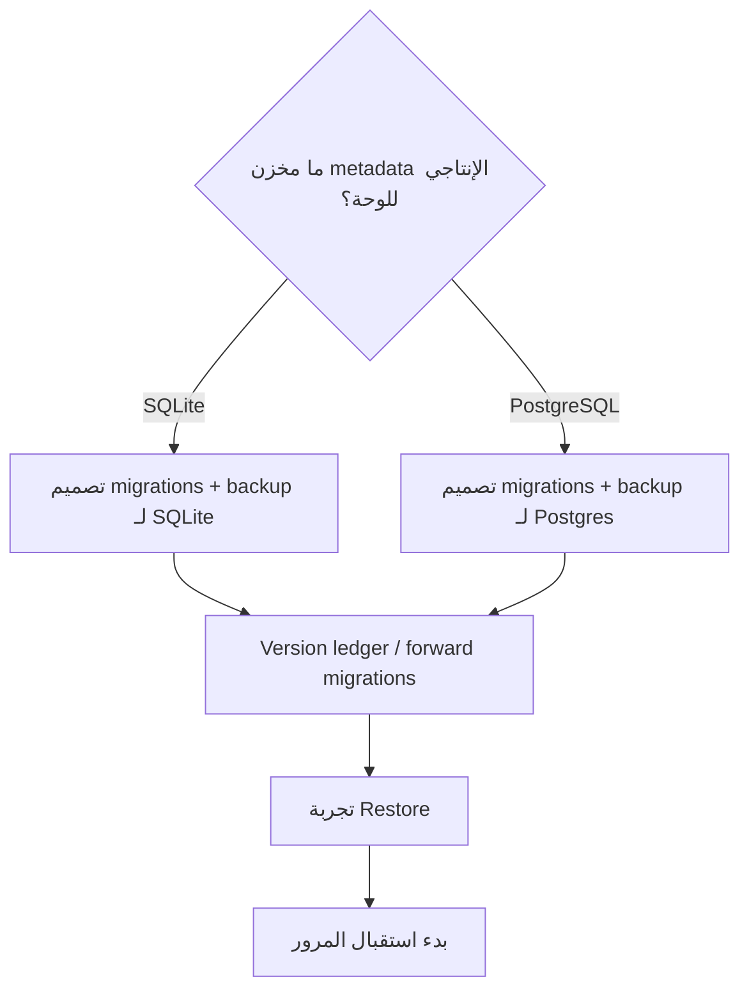

ملكية schema الخاصة بمصدر التحليلات تظل منفصلة عن ملكية metadata الخاصة باللوحات.

---

# 18. مقارنة مع حلول مؤسسية

| المنتج | الدرس المعماري المرتبط بنا |
| --- | --- |
| **Power BI Copilot** | جودة الذكاء الاصطناعي تعتمد على semantic models مجهزة؛ الحوكمة الدلالية تسبق التحليلات الموثوقة باللغة الطبيعية |
| **ThoughtSpot Spotter** | التحليلات الحوارية يجب أن تحل الطلبات فوق بنى دلالية محكومة وقابلة للتحقق، لا فوق توليد مباشر غير مضبوط |
| **Tableau Agent** | الاستكشاف والعرض باللغة الطبيعية يمكن أن يعيش داخل تجربة تحليلات مؤسسية محكومة |
| **Qlik Answers** | الواجهات الوكيلية يمكنها دمج مصادر مؤسسية مهيأة مع الحفاظ على شفافية المصدر |

الخلاصة معمارية وليست تقليداً تنافسياً:

> **LLM intent + governed semantics + deterministic/security boundaries** هو النمط المؤسسي الصحيح.

---

# 19. تسلسل التنفيذ المقترح


لا نزيد تعقيد prompt أو schema أو context الخاص بالـ LLM في هذه المرحلة إلا إذا أثبتت البيانات الحقيقية حاجة لذلك.

---

# 20. القرارات التقنية المطلوبة في الاجتماع

يجب أن نخرج من النقاش بإجابات أو مالكين لهذه الأسئلة:

1. ما مصدر التحليلات المعتمد تحديداً بعد مسار Odoo / Python الحالي؟
2. من يملك الـ schema والفهارس والـ credentials وإشعارات التغيير؟
3. ما هو grain المبيعات الدقيق وما تاريخ الاعتراف؟
4. ما حالات الطلبات / الفواتير التي تدخل في الحساب؟
5. كيف تمثل المرتجعات والإلغاءات والخصومات والضرائب والـ credits؟
6. كيف ترتبط معرفات شركات المصدر بمعرفات Analytics tenants؟
7. ما معرف الفرع المعياري؟
8. هل القيم المالية مطبعة بالفعل إلى عملة التقارير؟
9. ما watermark / revision / deletion semantics المتاحة؟
10. أي نظام يملك المصادقة الإنتاجية وصلاحيات الفروع؟
11. ما سياق البيانات الحقيقية المسموح بإرساله لكل نشر LLM؟
12. ما الشهر المغلق والتقرير الذي سيصبح مرجع المصالحة؟

هذه الإجابات هي التي تحدد تنفيذ أول adapter.

---

# مراجع مؤسسية

- Microsoft Learn — *Use Copilot with semantic models in Power BI*  
  https://learn.microsoft.com/power-bi/create-reports/copilot-semantic-models
- Microsoft Learn — *Copilot for Power BI overview*  
  https://learn.microsoft.com/power-bi/create-reports/copilot-introduction
- ThoughtSpot — *Spotter*  
  https://www.thoughtspot.com/product/agents/spotter
- Tableau — *Tableau Agent*  
  https://www.tableau.com/products/tableau-agent
- Qlik Help — *Qlik Answers*  
  https://help.qlik.com/en-US/cloud-services/Subsystems/Hub/Content/Sense_Hub/QlikAnswers/Qlik-Answers.htm

---

# المراجع الداخلية

- `AGENTS.md`
- `docs/architecture/system-design.md`
- `docs/architecture/data-flow.md`
- `docs/architecture/source-integration.md`
- `docs/architecture/database-migrations.md`
- `docs/architecture/runtime-and-deployment.md`
- `docs/architecture/adr/002-semantic-model.md`
- `docs/architecture/adr/003-repository-port.md`
- `docs/architecture/adr/005-source-adapters.md`
- `docs/architecture/adr/018-multi-user-authorization.md`
- `docs/architecture/adr/023-execution-and-runtime-readiness.md`
- `docs/integration/production-readiness.md`
- `docs/integration/questions-for-malik.md`
- `docs/integration/real-data-contract.md`
- `docs/integration/reconciliation-plan.md`
