# El Dabboos Analytics — Technical Presentation

> Phase 1: Real-data integration and production-readiness architecture

---

# 1. Current system

El Dabboos Analytics is a governed multi-tenant analytics platform with:

- React web application,
- Fastify API,
- application use cases and planners,
- source-independent domain contracts,
- deterministic analytics engine,
- replaceable repository adapters,
- structured OpenAI-compatible LLM integration,
- bilingual EN / AR UX,
- versioned dashboard persistence.

Current production boundary:

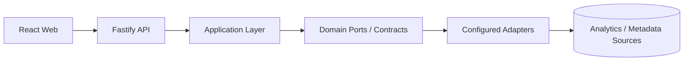

Compile-time dependency direction remains inward toward the domain.

---

# 2. Core architectural rule

Natural language never becomes executable infrastructure directly.

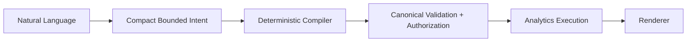

The LLM does **not** write:

- SQL,
- React,
- raw colors,
- arbitrary chart configuration,
- authorization filters,
- tenant policy,
- database identifiers.

LLM latency is treated as a product constraint.

---

# 3. Existing application contracts

The important stable source boundary is:

```ts
interface AnalyticsRepository {
  execute(
    query: AnalyticsQuery,
    context: AnalyticsContext
  ): Promise<AnalyticsResult>;
}
```

`AnalyticsContext` contains only resolved execution constraints:

```ts
{
  tenantId,
  locale,
  enforcedFilters
}
```

The repository does not need user objects, roles, emails, access tokens, or UI state.

This port should remain unchanged unless real source evidence proves a missing capability.

---

# 4. Current vs production data path

## Current prototype

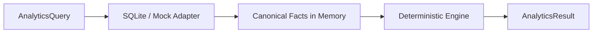

This is correct for deterministic validation and contract testing.

It is **not** evidence of production-scale execution because SQLite currently loads relevant tenant measures into memory.

## Production target

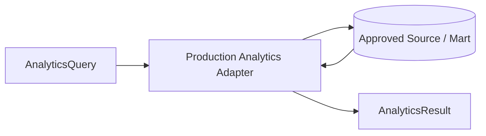

Filtering, aggregation, source limits, and cancellation should be pushed toward the production source where appropriate.

---

# 5. Proposed source integration

The most likely topology is:

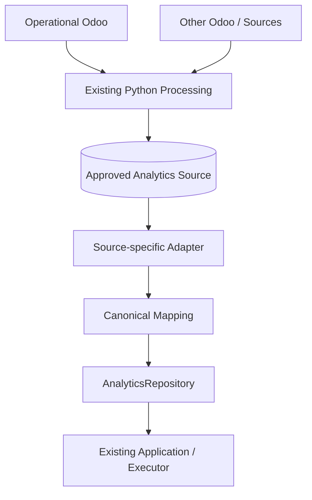

But **the source is still a decision**, not an assumption.

Possible adapter implementations:

- `PostgresAnalyticsRepository`
- approved source API adapter,
- replica-backed adapter,
- another company-owned mart adapter.

We should not code an Odoo-specific repository until Malik confirms the actual source contract.

---

# 6. Canonical source mapping

The domain semantic layer owns business-independent metric semantics.

Examples:

```text
revenue              -> additive source measure
order_count          -> additive source measure
average_order_value  -> revenue / order_count
gross_margin         -> gross_profit / net_revenue
win_rate             -> won / closed opportunities
```

Derived metrics must remain derived.

Production ingestion should never send independently summable:

- `average_order_value`,
- `gross_margin`,
- `sales_growth`,
- `win_rate`,
- `mtbf`,
- `mttr`.

---

# 7. Production source envelope

The current internal `AnalyticsFact` is intentionally small:

```text
tenantId
measureId
date
value
entityId?
dimensions
```

For production integration, the adapter boundary will need evidence for additional concepts such as:

```text
stable source event identity
source revision / version
transaction currency
base currency
reporting currency
source extraction watermark
batch / revision identity
correction / deletion semantics
```

Recommended principle:

> Keep these as source-integration concerns unless a proven cross-application requirement requires expanding the public domain contract.

Do not make the dashboard schema carry operational-source metadata.

---

# 8. First real Sales slice

Limit the first adapter to:

- one pilot tenant,
- one approved reporting currency,
- one closed month,
- Revenue,
- Net Revenue,
- Order Count,
- monthly grouping,
- branch grouping.

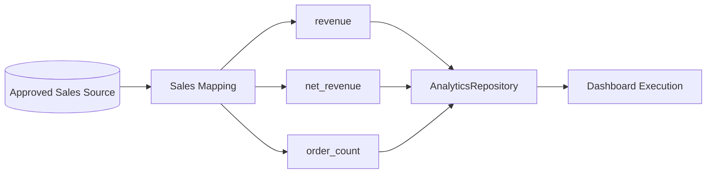

Do not begin with every domain, snapshot metric, or currency scenario.

---

# 9. Reconciliation is part of architecture

Passing unit tests is not enough for a real adapter.

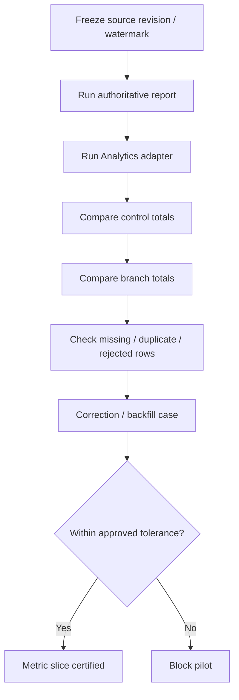

Tolerance must come from the business owner.

We should not invent a generic percentage tolerance.

---

# 10. Tenant / company / branch identity

Production mapping must establish:

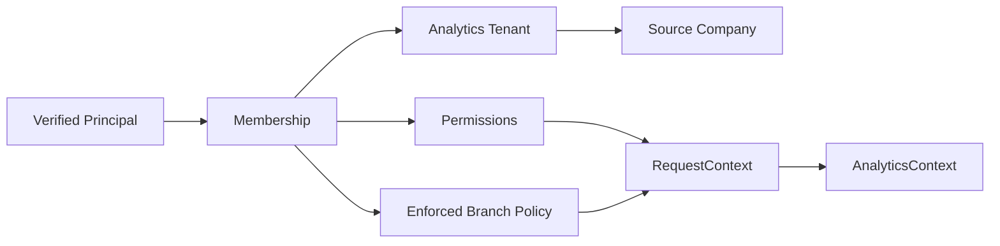

Important invariant:

**requested filters and policy filters remain separate.**

A dashboard may request Basra; a Baghdad-only user still cannot receive Basra data.

The repository receives the intersection through resolved execution context.

---

# 11. Currency boundary

Currency must be resolved before monetary aggregation.

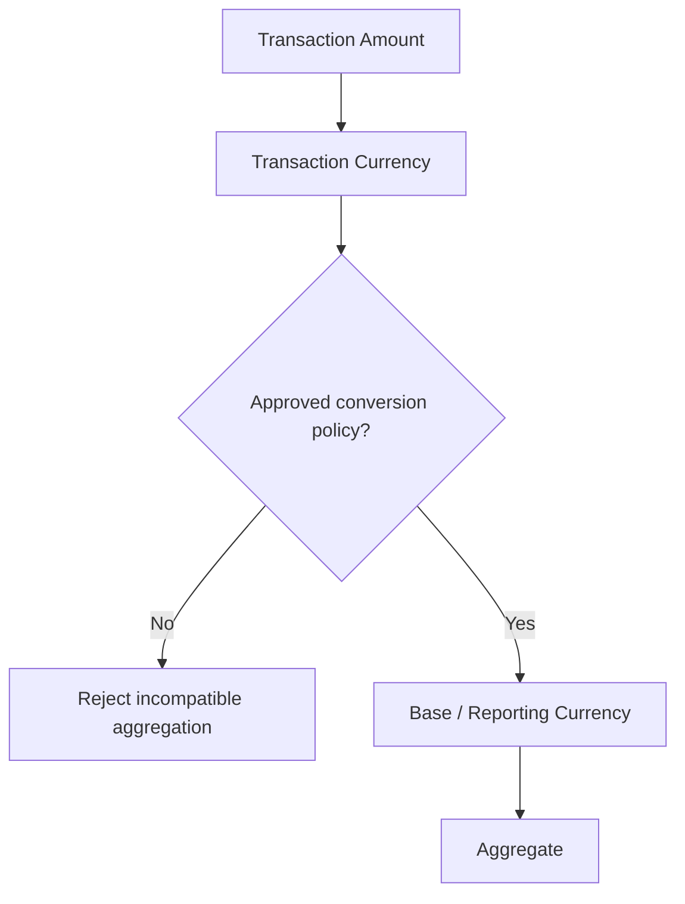

The current demo tenant profile saying `IQD` or `EGP` is presentation metadata, not proof that every operational fact is already normalized.

Fail closed on mixed or unknown currencies.

---

# 12. Freshness, corrections, and deletes

Keep two different concepts:

- **dataThrough** — latest business date represented by relevant data,
- **sourceAsOf** — known extraction / synchronization timestamp.

Do not infer one from the other.

Production source mapping also needs:

- stable source event identity,
- idempotent replay,
- backfill behavior,
- revision handling,
- deletion / tombstone / reversal policy,
- partial-batch completeness rules.

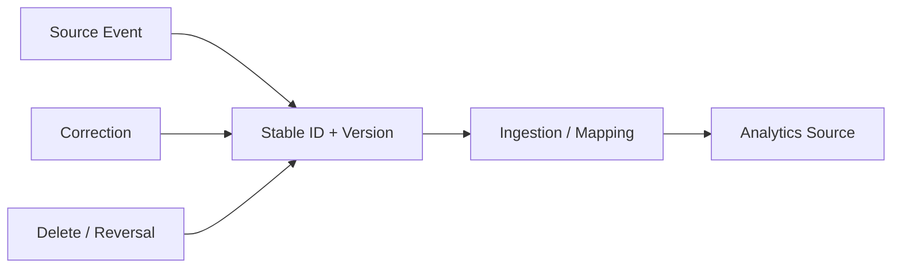

---

# 13. LLM privacy boundary

Real customer data changes the planner threat model.

Current planning already avoids analytics result rows by default.

Production should add a provider-specific export policy:

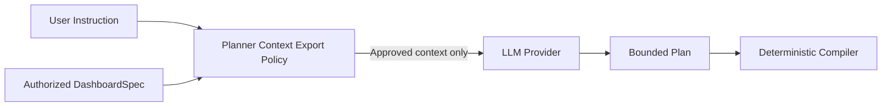

The export policy decides whether a provider may receive:

- dashboard titles,
- branch identifiers,
- customer identifiers,
- product identifiers,
- filter values,
- free-text instructions.

External provider approval and company-hosted/local provider approval may differ.

This policy should live at planner composition / provider boundary, not inside `DashboardSpec`.

---

# 14. Production identity

Replace demo headers with a real IdentityProvider implementation.

The rest of the application should continue consuming the same `RequestContext`.

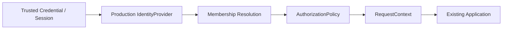

Open questions:

- Is Odoo identity authoritative?
- Is the Python backend already validating the user?
- Is there external SSO / IdP?
- How quickly must membership revocation propagate?
- Which source owns branch access and metric-domain permissions?

---

# 15. Runtime requirements for a real source

Current request-local execution already provides:

- query normalization,
- request-local deduplication,
- bounded unique-query concurrency.

Production adapter still needs:

- source-native timeout,
- cancellation,
- connection pooling,
- backpressure,
- process-wide capacity control,
- safe retry rules,
- source readiness probe,
- latency instrumentation.

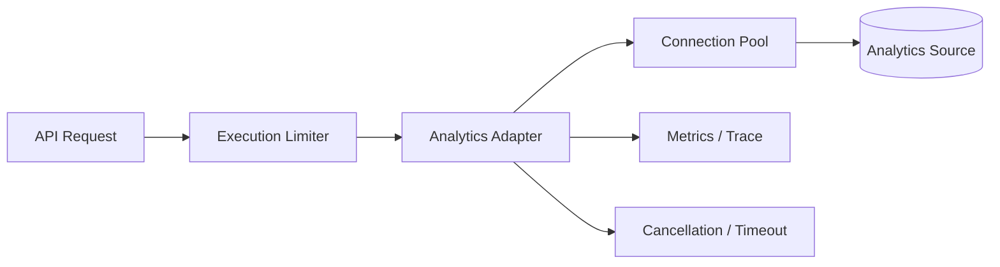

---

# 16. Observability

Recommended correlation path:

```text
requestId
traceId
tenantId
route
HTTP status
total latency
analytics adapter latency
LLM latency
failed-series count
source identifier
```

Do not log by default:

- API keys,
- auth headers,
- raw prompts,
- raw result rows,
- complete customer filters,
- source credentials.

Persistent audit should be designed separately from operational tracing.

---

# 17. Metadata DB and migrations

Do not build a heavy migration framework before choosing the production metadata store.

Decision first:

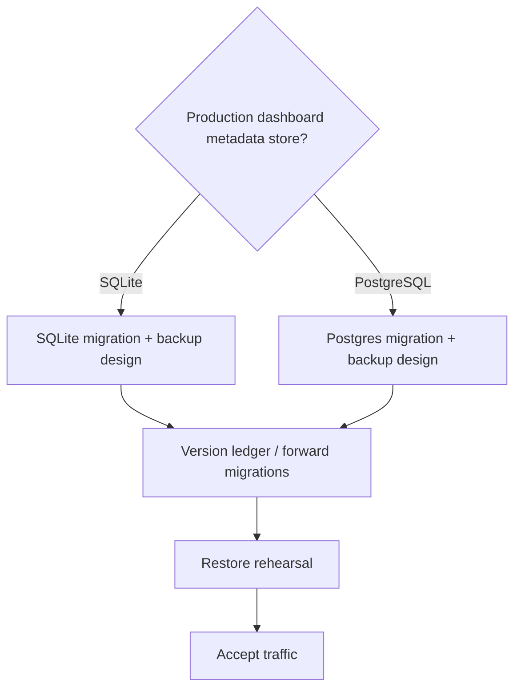

Analytics-source schema ownership remains separate from dashboard metadata ownership.

---

# 18. Enterprise solution comparison

| Product | Architectural lesson relevant to us |
| --- | --- |
| **Power BI Copilot** | AI quality depends on prepared semantic models; semantic governance comes before reliable natural-language analytics |
| **ThoughtSpot Spotter** | Conversational analytics should resolve against governed, verifiable semantic constructs rather than uncontrolled direct generation |
| **Tableau Agent** | Natural-language exploration and visualization can live inside an enterprise-governed analytics experience |
| **Qlik Answers** | Agentic interfaces can combine curated enterprise sources while preserving source transparency |

The takeaway is architectural, not competitive imitation:

> **LLM intent + governed semantics + deterministic/security boundaries** is the right enterprise pattern.

---

# 19. Recommended implementation sequence

```mermaid
flowchart LR
    A[Malik / business decisions] --> B[Sales metric sign-off]
    B --> C[Source mapping contract]
    C --> D[Adapter contract tests]
    D --> E[Production adapter]
    E --> F[Reconciliation]
    F --> G[Timeout / cancellation / pool]
    G --> H[Tracing / operational readiness]
    H --> I[Production identity]
    I --> J[Single-tenant pilot]
```

Do not increase LLM prompt, schema, or context complexity as part of this phase unless real evidence requires it.

---

# 20. Technical decisions requested in the meeting

We should leave the discussion with answers or owners for:

1. What exactly is the approved analytics source after the current Odoo / Python pipeline?
2. Who owns its schema, indexes, credentials, and change notifications?
3. What is the exact Sales grain and recognition date?
4. Which order / invoice states count?
5. How are returns, cancellations, discounts, tax, and credits represented?
6. How do source company IDs map to Analytics tenant IDs?
7. What is the canonical branch identifier?
8. Are monetary rows already normalized to reporting currency?
9. What watermark / revision / deletion semantics are available?
10. What system owns production authentication and branch permissions?
11. What real-data context may each LLM deployment receive?
12. Which closed month and report become the reconciliation control?

Those answers determine the first adapter implementation.

---

# Enterprise references

- Microsoft Learn — *Use Copilot with semantic models in Power BI*  
  https://learn.microsoft.com/power-bi/create-reports/copilot-semantic-models
- Microsoft Learn — *Copilot for Power BI overview*  
  https://learn.microsoft.com/power-bi/create-reports/copilot-introduction
- ThoughtSpot — *Spotter*  
  https://www.thoughtspot.com/product/agents/spotter
- Tableau — *Tableau Agent*  
  https://www.tableau.com/products/tableau-agent
- Qlik Help — *Qlik Answers*  
  https://help.qlik.com/en-US/cloud-services/Subsystems/Hub/Content/Sense_Hub/QlikAnswers/Qlik-Answers.htm

---

# Internal references

- `AGENTS.md`
- `docs/architecture/system-design.md`
- `docs/architecture/data-flow.md`
- `docs/architecture/source-integration.md`
- `docs/architecture/database-migrations.md`
- `docs/architecture/runtime-and-deployment.md`
- `docs/architecture/adr/002-semantic-model.md`
- `docs/architecture/adr/003-repository-port.md`
- `docs/architecture/adr/005-source-adapters.md`
- `docs/architecture/adr/018-multi-user-authorization.md`
- `docs/architecture/adr/023-execution-and-runtime-readiness.md`
- `docs/integration/production-readiness.md`
- `docs/integration/questions-for-malik.md`
- `docs/integration/real-data-contract.md`
- `docs/integration/reconciliation-plan.md`
