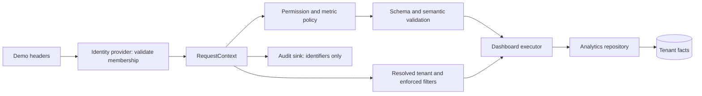

# Multi-user authorization foundation

Authentication is not implemented yet. The `x-demo-user-id` and `x-tenant-id` headers simulate a selected principal and tenant in a local demo. They are caller-controlled and must never be used as production authentication. There are no passwords, tokens, Odoo integration, persisted users, or sharing workflows.

A `User` is independent of a `Tenant`. `TenantMembership` binds one user to one tenant, with role IDs, permitted metric domains, and optional enforced filters. The regional demo user has separate Iraq and Egypt memberships. The server-owned `DemoIdentityProvider` rejects unknown users and absent memberships. A tenant header alone cannot establish access.

Permissions are the authorization primitive. Roles bundle permissions; API code asks `AuthorizationPolicy` for permissions and metric access without checking role names. The initial permissions cover dashboard view/create/edit/share, analytics query, AI generation/edit, and tenant/user management. The sales analyst demonstrates restricted metrics: sales and CRM are available, while finance and other domains are omitted from catalog and builder choices. Templates containing unauthorized metrics are marked restricted and cannot be instantiated. Handcrafted specs, planner output, and edits are checked after schema/semantic validation and before execution.

Policy filters stay in `RequestContext.authorization.enforcedFilters`. DashboardSpec contains only user-requested filters. The API derives a small `AnalyticsContext` containing tenant, locale, and enforced filters; no user, email, or role reaches the repository. The deterministic engine intersects requested and enforced filters. A Basra request from the Baghdad manager yields an empty or zero result, never Basra data. Snapshot selection is performed before policy filtering so an older entity snapshot from an allowed branch cannot appear after its latest branch changes. Dimension discovery receives the same resolved filters. A generated spec may group by branch, but execution still sees only Baghdad facts for the Baghdad manager.

Dashboard ownership is defined outside DashboardSpec as `DashboardRecord`, with private or tenant scope and actor identifiers, for future persistence. `AuditEvent` records tenant, user, membership, action, time, result and optional dashboard/provider/model/trace identifiers. The current sink is in memory. Raw prompts and customer analytics values are not part of the event contract.

## Trust boundaries

Production authentication, Odoo group mapping, user lifecycle, and company/branch policy ownership remain open pending Malik's answers. The eventual identity adapter should resolve the same `RequestContext` contract; the demo headers must be removed or isolated before deployment.
